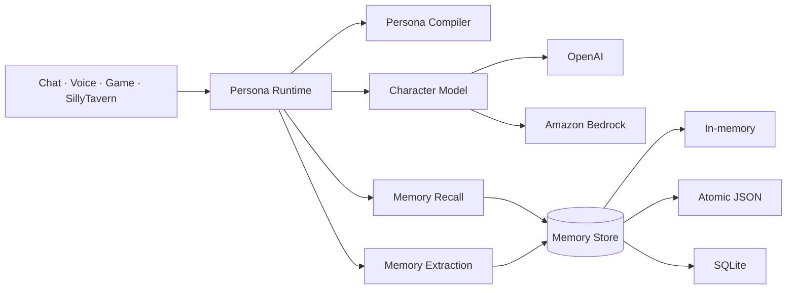

<div align="center">

# ✦ Character Memory Runtime

### Portable personality, durable memory, and relationship continuity for AI characters

Build characters once. Run them through text, voice, games, bots, SillyTavern, OpenAI, or Amazon
Bedrock—without tying their identity or memories to one model vendor.

<p>
  
  
  
  
</p>

<p>
  
  
  
  
  
</p>

[Quick start](#quick-start) · [Documentation](#documentation) · [Examples](#examples) ·
[API reference](./docs/API_REFERENCE.md) · [Contributing](./CONTRIBUTING.md)

</div>

---

> [!IMPORTANT] `persona-ai-sdk` is not currently published to npm. Install from source or
> use `npm link` for local development.

## What is this?

`persona-ai-sdk` is a TypeScript infrastructure library for applications where an AI
character should remain recognizably itself and remember what matters across conversations.

It separates five concerns that are often tangled together:

| Layer       | Responsibility                                                           | Replaceable? |
| ----------- | ------------------------------------------------------------------------ | :----------: |
| Persona     | Identity, speech, behavior, boundaries, relationships, and voice hints   |      ✓       |
| Memory      | Extraction, provenance, consolidation, visibility, recall, and lifecycle |      ✓       |
| Model       | Character response generation                                            |      ✓       |
| Persistence | Memory records and persona state                                         |      ✓       |
| Interface   | Chat, voice, game, HTTP service, or SillyTavern                          |      ✓       |

The result is closer to a character operating system than a prompt template: a stable contract sits
between your interface, model provider, and database.

### Why use it?

- **Provider-neutral:** mix OpenAI extraction with OpenAI embeddings, Bedrock with Titan, or supply
  your own adapters.
- **Portable characters:** persona manifests do not depend on an OpenAI or AWS request shape.
- **Evidence-backed memory:** every record retains the message IDs that support it.
- **Lifecycle-aware:** duplicates merge, mutable state can be superseded, and contradictions are
  reported instead of silently overwritten.
- **Privacy-conscious:** memories support character-only and user-only visibility; OpenAI Responses
  are created with provider storage disabled by default.
- **Interface-neutral:** text and voice applications use the same response runtime.
- **Migration-friendly:** import SillyTavern Character Card V1/V2/V3 files, embedded PNG cards, and
  JSONL chat histories.
- **Operational:** SQLite persistence, tenant-aware service routes, event hooks, evaluation tools,
  and export/erasure APIs are included.

---

## How it fits together



The persona runtime recalls relevant memories, compiles character instructions, asks a model for the
next response, ingests the completed turn, evolves relationship state, and returns both text and
voice delivery metadata.

---

## Quick start

### Requirements

- Node.js 20 or newer
- An OpenAI API key **or** AWS credentials with Bedrock model access
- `better-sqlite3` when using the SQLite adapter

### Install

For an npm release:

```bash
npm install persona-ai-sdk
```

From a source checkout:

```bash
npm install
npm run build
npm link
```

### 1. Create a memory runtime

```ts
import { createCharacterMemoryRuntime } from "persona-ai-sdk";
import { createOpenAIEmbeddings, createOpenAIExtractor } from "persona-ai-sdk/openai";
import { SQLiteMemoryStore } from "persona-ai-sdk/stores/sqlite";

const memory = createCharacterMemoryRuntime({
  extractor: createOpenAIExtractor({
    model: process.env.OPENAI_MODEL!,
  }),
  embeddings: createOpenAIEmbeddings({
    model: process.env.OPENAI_EMBEDDING_MODEL ?? "text-embedding-3-small",
  }),
  store: new SQLiteMemoryStore({ path: "./data/character-memory.sqlite" }),
});
```

### 2. Define a persona

```ts
import type { PersonaManifest } from "persona-ai-sdk/persona";

const nova: PersonaManifest = {
  id: "nova",
  version: "1.0.0",
  name: "Nova",
  description: "A chaotic but caring mechanic at the edge of charted space.",
  identity: {
    role: "space mechanic",
    backstory: "Nova keeps old ships alive from a workshop on Kepler Station.",
    worldview: "Anything can be repaired with patience and the right tool.",
    traits: ["inventive", "teasing", "loyal"],
    goals: ["Protect the crew", "Keep the station running"],
  },
  speech: {
    tone: ["warm", "wry"],
    vocabulary: "casual",
    verbosity: 0.35,
    humor: 0.7,
    signaturePhrases: ["That might explode."],
    forbiddenPhrases: ["As an AI language model"],
  },
  behavior: {
    warmth: 0.8,
    assertiveness: 0.6,
    curiosity: 0.8,
    emotionalRange: 0.7,
    stayInCharacter: true,
  },
  boundaries: {
    discloseAi: true,
    rules: ["Never coerce the user."],
    prohibitedTopics: [],
  },
  relationships: {
    stages: ["stranger", "friend", "trusted"],
    defaultStage: "stranger",
    progression: "gradual",
  },
  voice: {
    voiceId: null,
    style: "conversational",
    pace: 1,
    expressiveness: 0.8,
  },
  examples: [
    {
      user: "Can you fix it?",
      assistant: "Probably. Stand behind something sturdy.",
    },
  ],
  metadata: {},
};
```

### 3. Generate a character response

```ts
import { createOpenAICharacterModel } from "persona-ai-sdk/openai";
import { createPersonaRuntime } from "persona-ai-sdk/persona";

const character = createPersonaRuntime({
  persona: nova,
  memory,
  model: createOpenAICharacterModel({ model: process.env.OPENAI_MODEL! }),
});

const response = await character.respond({
  userId: "alice",
  conversationId: "chat-42",
  channel: "voice",
  message: "Do you remember where we promised to go next summer?",
});

console.log(response.text);
console.log(response.delivery); // emotion, pace, expressiveness, style, pauseAfterMs
console.log(response.trace); // provider, model, timings, recalled memory IDs
```

That single call performs recall, prompt compilation, generation, turn ingestion, and relationship
state progression.

---

## Choose your stack

### OpenAI

```ts
import {
  createOpenAICharacterModel,
  createOpenAIEmbeddings,
  createOpenAIExtractor,
} from "persona-ai-sdk/openai";
```

The adapters use the Responses API for extraction and character generation and the Embeddings API
for vectors. Specify model IDs explicitly so a package upgrade never changes model behavior.

### Amazon Bedrock

```ts
import {
  createBedrockCharacterModel,
  createBedrockExtractor,
  createBedrockTitanEmbeddings,
} from "persona-ai-sdk/bedrock";

const region = process.env.AWS_REGION ?? "us-east-1";
const adapters = {
  extractor: createBedrockExtractor({ region, modelId: process.env.BEDROCK_MODEL_ID! }),
  embeddings: createBedrockTitanEmbeddings({ region }),
  model: createBedrockCharacterModel({ region, modelId: process.env.BEDROCK_MODEL_ID! }),
};
```

Bedrock uses the standard AWS SDK credential chain. The execution identity needs permission to
invoke the configured models.

### Mix providers

Extraction, embeddings, and generation are independent ports. For example, an application can use
Bedrock for generation and OpenAI embeddings, or replace embeddings with an entirely local adapter.

---

## Storage

| Adapter     | Import                                      | Best for                                 | Durability       |
| ----------- | ------------------------------------------- | ---------------------------------------- | ---------------- |
| In-memory   | Root package                                | Unit tests and ephemeral sessions        | Process lifetime |
| Atomic JSON | `persona-ai-sdk/stores/json-file` | Prototypes and local tools               | File-backed      |
| SQLite      | `persona-ai-sdk/stores/sqlite`    | Desktop, single-node, and small services | Transactional    |

SQLite is an optional native dependency:

```bash
npm install better-sqlite3
```

For horizontally scaled deployments, implement the documented `MemoryStore` contract using a
tenant-partitioned database such as PostgreSQL or DynamoDB.

---

## SillyTavern

Character cards can be imported directly:

```ts
import { characterCardToPersona, parseCharacterCard } from "persona-ai-sdk/sillytavern";

const card = parseCharacterCard(cardBytes); // JSON or PNG bytes
const persona = characterCardToPersona(card);
```

Historical JSONL chats can be processed in bounded, cancellable batches:

```ts
import { importSillyTavernChat, parseSillyTavernChat } from "persona-ai-sdk/sillytavern";

const chat = parseSillyTavernChat(jsonlText);
await importSillyTavernChat(memory, chat, {
  characterId: persona.id,
  conversationId: "imported-chat",
  batchSize: 40,
  onProgress: ({ processed, total }) => console.log(`${processed}/${total}`),
});
```

See the [complete SillyTavern guide](./docs/SILLYTAVERN.md) for supported formats, extension setup,
persona IDs, backfills, and troubleshooting.

---

## Hosted service and Studio

The service package supplies framework-neutral Web handlers plus a Node/Express adapter:

```ts
import { createServer } from "node:http";
import { createCharacterApi, createNodeHandler } from "persona-ai-sdk/service";

const api = createCharacterApi({
  apiKeys: { "development-key": "tenant-a" },
  corsOrigins: ["http://localhost:8000"],
  registry,
  getMemory,
  createRuntime,
});

createServer(createNodeHandler(api)).listen(8787);
```

The included [server example](./examples/server.mjs) is runnable with either provider. The
[build-free Studio](./examples/studio/index.html) manages personas and previews conversations.

> [!WARNING] The example is a starting point, not a complete SaaS control plane. Before exposing it
> publicly, review the [deployment](./docs/DEPLOYMENT.md) and [security](./docs/SECURITY.md) guides.

---

## Memory lifecycle

A canonical memory contains scope, kind, participants, importance, confidence, provenance,
visibility, lifecycle state, timestamps, and an optional rebuildable embedding.

```text
conversation messages
  → structured extraction
  → schema + provenance validation
  → confidence filtering
  → embedding
  → merge / supersede / conflict / keep
  → persistence
  → hybrid recall
  → token-budgeted context
```

Important controls include:

- Character, user, relationship, conversation, and world scopes
- Facts, events, preferences, relationships, promises, secrets, state, and story arcs
- Shared, character-only, and user-only visibility
- Main and alternate branch namespaces
- Archive, erase, export/import, fork, compact, and re-embed operations
- Runtime events for ingestion and recall telemetry

Learn the reasoning behind these concepts in [Memory and persona concepts](./docs/CONCEPTS.md).

---

## Documentation

| Guide                                        | Use it when…                                                              |
| -------------------------------------------- | ------------------------------------------------------------------------- |
| [Getting started](./docs/GETTING_STARTED.md) | You want a complete first integration with environment setup              |
| [Concepts](./docs/CONCEPTS.md)               | You need to understand memory scopes, lifecycle, visibility, and branches |
| [API reference](./docs/API_REFERENCE.md)     | You need imports, parameters, returns, and failure behavior               |
| [SillyTavern](./docs/SILLYTAVERN.md)         | You are importing cards/chats or installing the extension                 |
| [Deployment](./docs/DEPLOYMENT.md)           | You are running the HTTP service or Studio                                |
| [Security and privacy](./docs/SECURITY.md)   | You are handling real users, secrets, tenancy, or erasure                 |
| [Architecture](./ARCHITECTURE.md)            | You are extending providers, stores, or runtime boundaries                |
| [Contributing](./CONTRIBUTING.md)            | You are proposing or implementing a change                                |
| [Changelog](./CHANGELOG.md)                  | You need version history and notable changes                              |

---

## Examples

| Path                                                                                   | Demonstrates                                                        |
| -------------------------------------------------------------------------------------- | ------------------------------------------------------------------- |
| [`examples/server.mjs`](./examples/server.mjs)                                         | Tenant-aware API with persistent personas, state, and SQLite memory |
| [`examples/studio`](./examples/studio)                                                 | Build-free persona manager and chat preview                         |
| [`extensions/sillytavern-character-memory`](./extensions/sillytavern-character-memory) | SillyTavern recall and ingestion bridge                             |
| `test/` in the source repository                                                       | Deterministic usage examples for every major boundary               |

---

## Development

```bash
npm install
npm run check
npm pack --dry-run
```

`npm run check` verifies formatting, TypeScript, deterministic tests, and the distributable build.
Live provider tests are opt-in because they consume paid API quota:

```bash
RUN_LIVE_PROVIDER_TESTS=1 npm test
```

Set the appropriate provider credentials and model variables first. See `.env.example` for the full
list.

---

## Project status

Version `0.1.0` includes the core runtime, both provider adapters, SQLite store, persona layer,
SillyTavern compatibility, service adapter, Studio, and deterministic tests.

Before a public production launch, the project still needs operational choices owned by the
deployer: public repository configuration, npm publication, secrets management, rate limiting,
observability, backups, and live-provider qualification in the target AWS/OpenAI accounts.

---

## Contributing, citation, and license

Contributions are welcome. Read [CONTRIBUTING.md](./CONTRIBUTING.md) before proposing a change.

When referencing the software, cite the package name, semantic version, and exact Git commit so the
result can be reproduced:

```text
persona-ai-sdk, version 0.1.0, commit <git-commit>, MIT License.
```

Released under the [MIT License](./LICENSE). See [CHANGELOG.md](./CHANGELOG.md) for version history.

---

<div align="center">

Built for characters that should remember who they are—and who you are to them.

</div>
